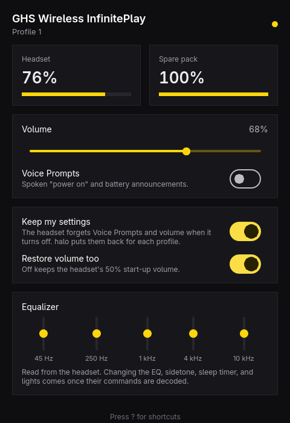

# halo

Settings for the Glorious **GHS Wireless InfinitePlay** headset on Linux.



The headset works on Linux as a standard USB headset, but its settings live
in Glorious CORE, which only runs on Windows. halo reads and changes them
directly over USB, and fixes one long-standing annoyance: the headset turns
Voice Prompts back on and resets its volume to 50% every time it powers on.
halo notices and puts your settings back, per profile.

halo is an unofficial, open-source project. It isn't made by, endorsed by, or
affiliated with Glorious.

## What it does

- Headset and spare battery levels
- Volume and Voice Prompts
- Keeps Voice Prompts and volume across power-ons, per profile
- Shows the EQ bands (changing them comes once the commands are decoded)
- A command line for scripts and agents

Sidetone, mic level, the sleep timer, and the base lights aren't decoded yet.
[docs/capturing.md](docs/capturing.md) explains how to help.

## Install

On Omarchy or Arch:

```sh
git clone https://github.com/EskimoDirka/halo
cd halo
bin/install
```

This installs the app, its launcher entry, a udev rule that lets the
logged-in user talk to the receiver, and a systemd user service. Unplug and
replug the receiver once after installing.

To keep settings across power-ons even when the window is closed:

```sh
systemctl --user enable --now halo-watch
```

## Shortcuts

| Key | Action |
|---|---|
| Space | Voice Prompts on or off |
| ↑ / ↓ | Volume up or down |
| K | Keep my settings on or off |
| R | Read the headset again |
| Ctrl+Z / Ctrl+Shift+Z | Undo / redo |
| ? | Show or hide shortcuts |
| Q | Quit |

## Command line

```sh
halo status [--json]
halo set volume <0-100> [--json]
halo set prompts <on|off> [--json]
halo watch                  # what the halo-watch service runs
halo skill install          # agent skill for Claude Code
```

Each exits 0 on success, or 1 with the error on stderr.

## How it works

The receiver takes settings commands on HID report `0x15`.
[docs/protocol.md](docs/protocol.md) has everything known so far, how each part
was worked out, and how sure it is. halo only sends commands seen from
Glorious CORE itself.

Firmware research, aiming for a headset that keeps its own settings, is in
[docs/firmware.md](docs/firmware.md).

## Development

```sh
bin/build    # build/halo
bin/test     # tests run offscreen, no headset needed
```

C++17 and Qt Quick, built with qmake. Translations live in `src/i18n/`
(Danish, German, and Spanish so far); halo follows Omarchy's language setting.

## License

MIT. Theme and language handling follow Omacut (MIT, David Heinemeier Hansson).
